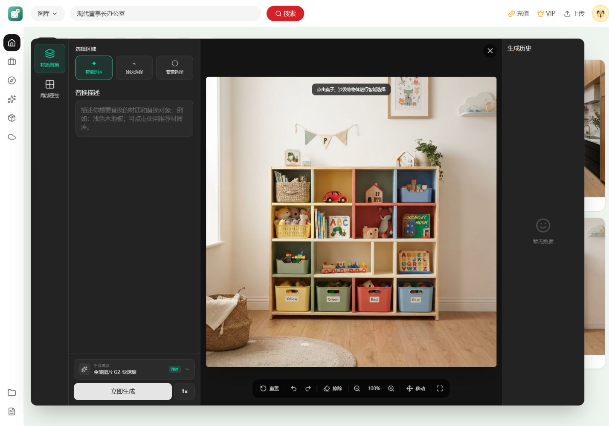

# 灵犀 · AI 快速编辑原型

围绕一张灵感图片继续编辑：查看图片上下文、选择编辑区域、组织描述与参考内容，再调整参数。

## 当前能力

- 从图库与图片详情进入编辑器，保留原始图片上下文。
- 通过智能、涂抹或套索选区表达编辑范围，结合文字和可选参考图说明意图。
- 部分局部重绘的 G2-快速版已接入服务，其余工具与模型选项仍包含演示能力。
- 本轮品牌与展示截图没有执行模型生成；界面中的选项不等于所有能力均已接入。

## 本地运行

准备 Node.js 与 pnpm，在项目目录安装依赖后启动：

    pnpm install
    pnpm dev

本地原型可浏览已有界面。调用真实服务需自行配置 .env.example 对应环境变量；不要提交密钥、本地环境文件或敏感用户数据。

## 品牌与展示素材

[public/icon.svg](public/icon.svg) 是品牌母版：薄荷绿选区与暖白灵感卡相连，表达围绕原图继续探索。导航、编辑页、favicon 与导出图标共用此身份，不再使用默认占位标志。

- [编辑界面](docs/images/lingxi-editor.jpg)：实际编辑画布与参数区，未执行生成。
- [图片上下文](docs/images/lingxi-overview.jpg)：图库与灵感图片详情。
- [选区与参数](docs/images/lingxi-selection.jpg)：实际选区操作及编辑描述。
- [选区工具局部](docs/images/lingxi-parameters-core.jpg) / [画布局部](docs/images/lingxi-selection-core.jpg)：真实桌面界面的独立取景，便于窄幅宣传构图，不代表新增手机界面。

截图来自当前源代码的本机预览，说明界面和流程，不宣称已完成所有模型或外站功能验收。素材来源与对应版本记录见 [素材来源清单](docs/images/source-notes.json)，作品集按确定版本选用。
